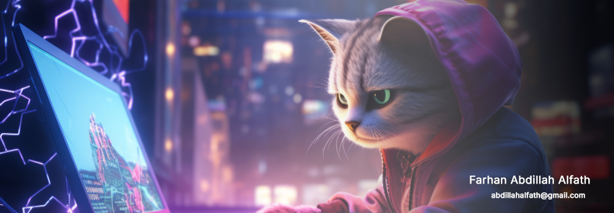

 

## 👋 Tentang Saya

Halo, saya Farhan, fullstack developer dari Lampung. Sehari-hari saya membangun aplikasi web dengan **Laravel** dan **Next.js**, dan belakangan makin banyak bereksperimen dengan **AI**.

- 🌱 Sedang mendalami cara kerja LLM, sampai membuat model bergaya GPT sendiri dari nol
- 🕌 Senang membuat aplikasi untuk belajar Al-Qur'an dan dunia pendidikan
- 🛠️ Suka mengerjakan produk dari ujung ke ujung, mulai dari database sampai tampilan

## 🚀 Proyek Pilihan

| Proyek | Tentang | Teknologi |
| --- | --- | --- |
| [**Quran Academy**](https://github.com/aalfath7/Quran-Academy) | Aplikasi web belajar Al-Qur'an yang disiapkan untuk berjalan di edge | Next.js, Cloudflare Workers, D1, Drizzle |
| [**Belajar Tajwid**](https://github.com/aalfath7/belajar-tajwid) | Materi hukum bacaan, contoh teks Arab, dan latihan interaktif | HTML, JavaScript |
| [**School Chatbot**](https://github.com/aalfath7/School-Chatbot-with-Qwen) | Chatbot informasi sekolah yang menjawab soal PPDB, biaya, dan program hanya dari data sekolah | Python, Qwen, Gradio, Ollama |
| [**Mini GPT**](https://github.com/aalfath7/Mini-GPT) | LLM mini bergaya GPT yang dibangun dari nol untuk memahami cara kerja Transformer | Python, PyTorch |
| [**Warehouse Apps**](https://github.com/aalfath7/warehouse-apps) | Aplikasi full-stack untuk mengelola inventaris dan transaksi gudang | TypeScript |

## ⚒️ Tech Stack

**Yang paling sering dipakai**

**Yang juga pernah dipakai**

## 📊 Statistik GitHub

  

